# Device Architecture

> Device model deep-dive (moved out of the top-level README to keep it focused). See also [`docs/plans/`](../plans/) and CLAUDE.md.

Devices are URI-addressed records that act as factories for their corresponding drivers via `NewInstanceFromDevice`. The hierarchy is rooted at `DeviceBase`:

```mermaid
graph LR
    subgraph Abstract
        DeviceBase
        GuiderDeviceBase
    end

    subgraph "ASCOM (Windows)"
        AscomDevice
        AscomCameraDriver
        AscomCoverCalibratorDriver
        AscomFilterWheelDriver
        AscomFocuserDriver
        AscomSwitchDriver
        AscomTelescopeDriver
    end

    subgraph "Alpaca (HTTP)"
        AlpacaDevice
        AlpacaCameraDriver
        AlpacaCoverCalibratorDriver
        AlpacaFilterWheelDriver
        AlpacaFocuserDriver
        AlpacaSwitchDriver
        AlpacaTelescopeDriver
    end

    subgraph ZWO
        ZWODevice
        ZWOCameraDriver
        ZWOFilterWheelDriver
        ZWOFocuserDriver
    end

    subgraph QHYCCD
        QHYDevice
        QHYCameraDriver
        QHYCameraControlledFilterWheelDriver
        QHYSerialControlledFilterWheelDriver
        QHYFocuserDriver
    end

    subgraph "Player One"
        PlayerOneDevice
        PlayerOneCameraDriver
    end

    subgraph "ToupTek (+ rebadged)"
        ToupTekDevice
        ToupTekCameraDriver
    end

    subgraph Gemini
        GeminiDevice
        GeminiFlatPanelDriver
        GeminiFocuserDevice
        GeminiFocuserDriver
    end

    subgraph Meade
        MeadeDevice
        MeadeLX200ProtocolMountDriver
    end

    subgraph iOptron
        IOptronDevice
        SgpMountDriver
    end

    subgraph OnStep
        OnStepDevice
        OnStepMountDriver
    end

    subgraph Skywatcher
        SkywatcherDevice
        SkywatcherMountDriver
    end

    subgraph Guiders
        BuiltInGuiderDevice
        BuiltInGuiderDriver
        OpenPHD2GuiderDevice
        OpenPHD2GuiderDriver
    end

    subgraph Fake
        FakeDevice
        FakeCameraDriver
        FakeFilterWheelDriver
        FakeFocuserDriver
        FakeGuider
        FakeMountDriver
        FakeMeadeLX200ProtocolMountDriver
        FakeSgpMountDriver
    end

    subgraph Sentinel
        NoneDevice
        Profile
    end

    DeviceBase --> AscomDevice
    DeviceBase --> AlpacaDevice
    DeviceBase --> ZWODevice
    DeviceBase --> QHYDevice
    DeviceBase --> PlayerOneDevice
    DeviceBase --> ToupTekDevice
    DeviceBase --> GeminiDevice
    DeviceBase --> GeminiFocuserDevice
    DeviceBase --> MeadeDevice
    DeviceBase --> IOptronDevice
    DeviceBase --> OnStepDevice
    DeviceBase --> SkywatcherDevice
    DeviceBase --> FakeDevice
    DeviceBase --> NoneDevice
    DeviceBase --> Profile
    DeviceBase --> GuiderDeviceBase
    GuiderDeviceBase --> BuiltInGuiderDevice
    GuiderDeviceBase --> OpenPHD2GuiderDevice

    AscomDevice -.-> AscomCameraDriver
    AscomDevice -.-> AscomCoverCalibratorDriver
    AscomDevice -.-> AscomFilterWheelDriver
    AscomDevice -.-> AscomFocuserDriver
    AscomDevice -.-> AscomSwitchDriver
    AscomDevice -.-> AscomTelescopeDriver

    AlpacaDevice -.-> AlpacaCameraDriver
    AlpacaDevice -.-> AlpacaCoverCalibratorDriver
    AlpacaDevice -.-> AlpacaFilterWheelDriver
    AlpacaDevice -.-> AlpacaFocuserDriver
    AlpacaDevice -.-> AlpacaSwitchDriver
    AlpacaDevice -.-> AlpacaTelescopeDriver

    ZWODevice -.-> ZWOCameraDriver
    ZWODevice -.-> ZWOFilterWheelDriver
    ZWODevice -.-> ZWOFocuserDriver

    QHYDevice -.-> QHYCameraDriver
    QHYDevice -.-> QHYCameraControlledFilterWheelDriver
    QHYDevice -.-> QHYSerialControlledFilterWheelDriver
    QHYDevice -.-> QHYFocuserDriver

    PlayerOneDevice -.-> PlayerOneCameraDriver
    ToupTekDevice -.-> ToupTekCameraDriver

    GeminiDevice -.-> GeminiFlatPanelDriver
    GeminiFocuserDevice -.-> GeminiFocuserDriver

    MeadeDevice -.-> MeadeLX200ProtocolMountDriver
    IOptronDevice -.-> SgpMountDriver
    OnStepDevice -.-> OnStepMountDriver
    SkywatcherDevice -.-> SkywatcherMountDriver

    BuiltInGuiderDevice -.-> BuiltInGuiderDriver
    OpenPHD2GuiderDevice -.-> OpenPHD2GuiderDriver

    FakeDevice -.-> FakeCameraDriver
    FakeDevice -.-> FakeFilterWheelDriver
    FakeDevice -.-> FakeFocuserDriver
    FakeDevice -.-> FakeGuider
    FakeDevice -.-> FakeMountDriver
    FakeDevice -.-> FakeMeadeLX200ProtocolMountDriver
    FakeDevice -.-> FakeSgpMountDriver
```

> Solid arrows = inheritance, dashed arrows = instantiates driver via `NewInstanceFromDevice`.

## Native serial protocols

The drivers TianWen speaks a device's own wire protocol to, with no ASCOM, Alpaca or vendor SDK in
between. Each has one architecture document: the framing, the commands, the connect handshake,
discovery, the fake, and a mapping from every driver member to the wire, including what the member
does when the device is connected and does not answer.

| Device | Document | Driver code | Transports |
|---|---|---|---|
| Meade LX200 (the base OnStep extends) | [`lx200-protocol.md`](lx200-protocol.md) | `Devices/MeadeLX200ProtocolMountDriverBase.cs`, `Devices/Meade/` | serial |
| OnStep / OnStepX | [`onstep-protocol.md`](onstep-protocol.md) | `Devices/OnStep/` | serial, TCP over WiFi (`Connections/TcpSerialConnection.cs`) |
| Skywatcher motor controller | [`skywatcher-protocol.md`](skywatcher-protocol.md) | `Devices/Skywatcher/` | serial, UDP over WiFi (`SkywatcherUdpConnection`) |
| iOptron SkyGuider Pro | [`sgp-protocol.md`](sgp-protocol.md) | `Devices/IOptron/` | serial |
| Gemini Focuser Pro | [`gemini-focuser-pro-protocol.md`](gemini-focuser-pro-protocol.md) | `Devices/Gemini/GeminiFocuser*.cs` | USB serial |
| Gemini FlatPanel Lite | [`gemini-flatpanel-lite-protocol.md`](gemini-flatpanel-lite-protocol.md) | `Devices/Gemini/GeminiFlatPanel*.cs` | USB serial |
| Gemini Power&Data Hub Advanced 3 | [`gemini-powerbox-adv3-protocol.md`](gemini-powerbox-adv3-protocol.md) | `Devices/Gemini/GeminiPowerBox*.cs` | USB serial |

All of them share the transport in `Connections/` (`ISerialConnection`, and `SerialConnection` for COM ports,
an adapter over the Serial.Lib sibling, docs/plans/serial-lib.md) and one rule from [`driver-resilience.md`](driver-resilience.md):
**a read the device did not answer throws a transient exception, never a value**, because the
session's retry and reconnect layer only ever sees exceptions. Where a driver still breaks that rule,
its document says so and #810 tracks the fix. A new native driver gets its document with its first
commit, not after.

## ToupTek: one binding for eleven libraries

`ToupTekDevice` covers ToupTek and the ten brands that ship the same SDK under their own library and
function prefix (Altair, Bresser, MallinCam, Nn, OGMAVision, Omegon, Orion, Teleskop Service, SVBONY's
ToupTek line, Meade). `ToupTek.SDK` resolves each brand's entry points at run time from its own library
handle, so a rebadged camera works wherever its library sits beside the app; only ToupTek's natives ship
in the package, and only a ToupTek body (G3M678M) has been verified. A camera enumerated by two brand
libraries is listed once, keyed by serial: the SDK's own id is a USB device PATH and names a port. The
device source shows a rebadged body under its brand name. ToupTek's own ASCOM driver
(`ASCOM.ToupTek.Camera1..3`) is hidden by `NativeDriverBlacklist` when the native camera is found,
because both opening one body fails the second with `E_BUSY`.

The binding's design notes (why the DAL struct keys into a session registry, the software-trigger
capture, the left-aligned 12-bit pixels, the Windows upside-down default, the frame-rate table and the
video-mode stall that `INativeDeviceInfo.ResetDevice` recovers) are in the ToupTek.SDK README.

## Device management rules (moved from CLAUDE.md, 2026-09-29)

URI-addressed: `DeviceBase` (URI identity), `IDeviceSource<T>` (driver backends),
`ICombinedDeviceManager` (coordinates sources), `IDeviceUriRegistry` (URI → instance map).
Each subclass reads query keys (`?key=value`) defined in `DeviceQueryKey`. See class XML doc comments
for supported keys. Full driver hierarchy (ASCOM / Alpaca / ZWO / QHY / native-serial subgraphs):
`docs/architecture/device-architecture.md`.

**Every native serial protocol has ONE architecture document** (LX200, OnStep, Skywatcher, SGP and
both Gemini devices, indexed under "Native serial protocols" in that file), and a new native driver
ships with its document in its first commit: OnStep went without one for five months and its wire
notes survived only in a commit message. Each maps every driver member to the wire, including what
it does when the device is connected and does not answer, which must be a transient THROW (#810).

**A node holds ONE driver per device, and a driver's connect is all or nothing (#806).** `DeviceHub` runs one
connect, adoption or disconnect of a device at a time (a gate per device key), so two at once (a session's
initialisation and an Alpaca `Connected=true`) leave one driver and hand both callers it. A driver the hub holds
that went down is RECONNECTED, the same instance, while its URI is unchanged, since a run still holds it and its
resilient calls reconnect it; only a changed URI under the same key builds a new one, and never while a run leases
the device (session end mirrors `focuserBacklashIn`/`Out` into a focuser's query). A changed URI under the same key
only ever happens for a family whose key survives a re-plug (see "Device keys by family" below).
`DeviceDriverBase` runs one connect or disconnect at a time per driver, and a connect whose transport will not
open, or whose `InitDeviceAsync` returns `false` or throws, closes what it opened and throws, leaving the driver
not connected: it used to read `Connected` after a refused init, so the retry skipped init and the disconnect had
no connection id to close. Pinned by `DeviceDriverConnectionTests` and `DeviceHubAdoptionTests`.

**A vendor's native binaries reach an app through the REFERENCE GRAPH, and nothing downstream can
filter them out.** The ZWO and QHYCCD drivers therefore live in `TianWen.Devices.Native`, not in
`TianWen.Lib`: an SDK project marks its natives `CopyToOutputDirectory` deliberately (a
`runtimes/<rid>/native` layout is a NuGet mechanism a `ProjectReference` does not honour), MSBuild
propagates that to every transitive consumer, and trimming cannot undo it because it reasons about
MANAGED reachability while a native library is an opaque blob a `DllImport` may resolve by name at run
time. Not calling `AddZWO()` changes nothing; only not referencing does. The viewer shipped 8.2 MB of
camera, focuser and filter-wheel drivers to the Store this way. **Namespaces stayed
`TianWen.Lib.Devices.*` / `TianWen.Lib.Extensions` on purpose** (a deployment split, not an API
redesign), so the assembly name and the namespace root differ; the drivers stay `internal` and see
Lib's internals through `InternalsVisibleTo` rather than the DAL abstraction being promoted to public
API. Only the process that drives hardware references the project, and since P6 (#936) that is `tianwen-server`
alone: the GUI, the CLI (the TUI with it) and `tianwen-fits` must NOT, and neither must a new consumer, which reaches
the rig through the node.

**A profile scan never probes a COM port, and a port that will not TAKE bytes is given up, not retried.**
`DiscoverOnlyDeviceType(type)` runs the serial probe pass only when a source for that type consumes it (it
used to run for `Profile` -- at GUI start-up on the main thread and from `MountLimitWatcher` every 5 s).
Serial.Lib (the sibling `SerialConnection` adapts to `ISerialConnection`) bounds every write twice (port
`WriteTimeout` + task deadline) and the close, because a Windows Bluetooth SPP listener port (`bthmodem.sys`, created for any paired
device advertising SPP) accepts an open and then never completes a write, and `SerialStream` ignores its
token. Only a write the driver never completed raises `ISerialConnection.HasAbandonedIo`, on which the pass
drops the port for the rest of the discovery; a READ timeout never does -- a device at the wrong baud or
awaiting another protocol completes the write and stays silent, and still gets every probe and baud. Found
and measured live 2026-08-30: `docs/plans/mount-safety-limits.md`,
"Live verification".

**Serial I/O is the Serial.Lib sibling's, and closing a connection is asynchronous.** `SerialConnection` only
adapts it to `ISerialConnection`: the library's typed failures become the `Try*` null / -1 / false, and reads are
bounded by the caller's token alone (`Timeout.InfiniteTimeSpan`), as they always were. `ISerialConnection` is
`IAsyncDisposable` and closes through `TryCloseAsync`; a synchronous `Dispose` that cannot await starts the close
with `CloseInBackground` and never waits on it. A new transport guarantee goes into Serial.Lib with a test there,
never into the adapter: `docs/plans/serial-lib.md`.

### Device keys by family

A device's key is `Uri.DeviceKey` (`DeviceUriExtensions`): scheme, host and path, compared with
`DeviceKeyComparer` (ordinal, case-insensitive). It is the ONE definition, and `DeviceKeyHasOneDefinitionTests` fails
on a second `GetLeftPart(UriPartial.Path)` anywhere in `src/`. `DeviceBase.DeviceId` (the path alone) is a NAME for a
device's files and secrets, never a comparison of two devices; the whole URI, query included, is the device as
configured.

"Identity lives in the path, transport in the query" is the design intent, and it is **not true for every family**.
The rule is identity first: a key names the hardware, and a serial port or USB path goes into it only where the device
offers nothing else. The Skywatcher handshake names the model and the firmware and nothing else, the SkyGuider Pro has
no serial number, and an LX200/OnStep mount has none when its spare site slot cannot take a UUID. The path is whatever
the device source writes, and these families write the port or the USB path into it:

| Family | Path id | Survives a re-plug on another port? |
|---|---|---|
| ZWO, QHY, Player One, ToupTek, SVBONY | serial number, else custom id, else the model name | yes (no port involved), except on the model-name fallback |
| Canon, raw USB (LibUsbDotNet; needs a WinUSB driver on Windows) | the USB descriptor's serial number, else the device path, else `VID:PID` | yes with a serial; **no** on the device-path fallback |
| Canon over WiFi | the PTP/IP responder GUID, else the IP address | yes with the GUID; **no** on the IP fallback |
| Canon, Windows' stock driver (WPD; the same USB cable) | the body's own DeviceInfo serial (32 hex digits), read once per path with no PTP session; the WPD path (the USB device instance, which on a body with no USB serial, an EOS 6D, is the hub and the hub port) rides in the `wpd=` query as transport state that `ReconcileUri` refreshes; a body that reports no serial, or does not answer a 3 s read, keeps the path as its key | yes with a serial: replugged into another port it is the same key (#1097); **no** on the path fallback |
| Alpaca | `uniqueId`; host, port and device number are query | yes |
| Meade, OnStep **with a UUID** (the probe writes one into a spare site slot) | model plus UUID | yes, and the same across USB and WiFi |
| Meade, OnStep **without a UUID** | model, site names **and the port** (`MeadeSerialProbe`, `OnStepSerialProbe`: "NOT transport-stable") | **no**: the key changes with the port |
| Skywatcher | `Skywatcher_<model>_<fw>_<port>` (`SkywatcherSerialProbe`) | **no** |
| iOptron SkyGuider Pro | `SkyGuider-Pro_<fw>_<port>` (`IOptronSerialProbe`) | **no** |
| Gemini Focuser Pro, FlatPanel Lite, Power&Data Hub Advanced 3 (CH340, no USB serial, no board id) | `GeminiFocuser_<port>`, `Gemini_<port>`, `GeminiPowerBox_<port>` | **no** |
| QHY CFW3 and QFOC over serial | `QHYCFW3_<port>`, `QFOC_<port>` | **no** |

So wherever the key carries the port or a USB path, a re-plug is a NEW device: a lease does not follow it,
`ReconcileUri` does not match it (it compares by `SameDevice`, which compares the path the port is in), and the hub's
"a changed URI under the same key is rebuilt" rule (#806) never applies to it.

**A profile follows such a device to its new port by its MODEL, when that is unambiguous** (#1744). Windows numbers a
CH340's COM port by the USB socket, so the same unit is `GeminiFocuser_COM3` in one socket and `GeminiFocuser_COM4` in the
next. `Uri.ModelKey` is the key with the trailing `_<port>` taken out (null for a key that does not end in its port), and
`ReconcileProfileData` runs a second pass after the identity match (`FollowMovedPort`): a slot whose device was not
discovered takes the ONE discovered device of its model that no other slot has, keeping the user's query keys; none or
several leaves the slot as stored, never guessed. A focuser's backlash history, filed under its device ID, moves with it
(`BacklashHistoryPersistence.FollowMovedFocusersAsync`, run by `NodeProfiles.ReconcileAllAsync`). Two identical units on
swapped sockets stay unresolved until #783's board fingerprint. Pinned by `DeviceDiscoveryExtensionsTests` and
`BacklashHistoryPersistenceTests` over stub discovery; **not yet seen with a real device moved** (bench check #1746).

Canon through WPD is keyed by the body's serial, because that is readable (`CanonDeviceSource.DiscoverWpdAsync`): a bare PTP `GetDeviceInfo`, no `OpenSession`, measured on an EOS 6D at 7 ms to open the device and 21 ms to read, and it changes nothing on the camera. It is not free of interference, though. While another program streamed live view, 2 of 11 such reads coincided with a live view frame answering `InternalError` (one frame, the next was fine; the error was stamped to the millisecond a read finished), so it is made once per path and remembered (`CanonBodyRegistry`), never for a camera a driver of this process holds: the driver records the serial its session reports, so discovery is told without opening the device. WPD wants the path as Windows wrote it, which is `CanonDevice.WpdDeviceId` (the `wpd=` value, else the URI path unescaped), never `DeviceId`, which is percent-escaped and which WPD rejects (#1096). Enumeration alone (`EnumerateWpdCameras`) opens nothing and caused no interference, but returns only the port-shaped path, which is why the serial needs the read. The Skywatcher, SkyGuider Pro, UUID-less LX200/OnStep, Gemini and QHY serial rows have no such option, and rely on the model match above.

### Known limitations of device keys

- **Same key, two devices.** ZWO, QHY, Player One and ToupTek fall back to the model name when a camera has no serial
  or custom id, so two same-model cameras without a serial share a key. ToupTek discovery skips the second one
  outright, and the Player One source already says the name is not unique.
- **The manual filter holder and the manual cover have a constant path (`manual`)** and keep the filter in the query.
  Two holders with different filters share one key (`filterwheel://manualfilterwheeldevice/manual`), and the hub
  hands the second the first's driver, which reads its filter from its own device: on a rig with manual holders on
  two OTAs, the second reports the first's filter. The owner has accepted this for now (review of #1089).
- **The port-qualified ids above** (Skywatcher, SkyGuider Pro, UUID-less LX200/OnStep) cannot be improved by reading more
  from the hardware, which offers no identity; what is left is a profile migration or a rule for matching a moved mount,
  which is work of its own (#1090).

### Every call into a vendor SDK passes the gate

Tracked by #1758. A native call made on a device its SDK has closed is a use-after-free inside the vendor's library: an
access violation no .NET handler catches, which ends the whole node with any camera's cooler left as it was (a QHY178M
faulted that way on 2026-10-22, there on a handle never initialised). Telemetry reads, exposure polls and downloads run
outside the connect/disconnect transition, so a poll or a download could be inside the SDK when a disconnect, a forced
disconnect at shutdown or the driver's own reset closed it.

So `DALDeviceDriverBase` keeps a gate in front of the SDK, with no lock: **every call into it through `_deviceInfo` goes
inside `using var sdk = EnterSdk();` and makes no call when `sdk.Entered` is false**, answering as a closed device does
(a refused read is NaN or false, a refused command throws `NotConnectedException`). A caller counts itself in and then
looks at the gate; a closer shuts the gate and then waits for the count to drain (`CloseSdkGateAsync`), both full
fences, so either the caller backs out or the closer waits for it. A camera aborts an exposure going on before the wait
(`OnSdkClosing`), so a download blocked on it comes back. **A close that is not drained within `SdkDrainTimeout` (30 s)
does not close**: the disconnect fails and is tried again, a leaked handle being better than a dead node. The reset and
the reopen are closers too, holding the SDK themselves while the gate is shut (`HoldSdk`), so a disconnect arriving
meanwhile waits for them, and the gate opens again only when the last closer ends (`EndSdkClose`).

Exempt, deliberately: calls made inside the connect transition (`InitDeviceAsync`, `InitCamera`), which no close can run
beside; a video stream's own calls, which its disconnect waits out before closing; and values a binding caches at open
(size, Bayer pattern, name). An `InitDeviceAsync` that fails does not close the device itself: the connect closes what it
opened (`ReleaseFailedConnectionAsync`), through the gate, and closing in both places closed it twice. The ZWO wheel and
focuser call ZWO's functions by id rather than through `_deviceInfo`, and ZWO answers a closed id with an error, not a
fault. Each binding owes the same guarantee inside itself (#1759, #1760). Pinned by `DALCameraSdkGateTests`.

### A focuser's travel: MinStep to MaxStep

A focuser's position lies in `[IFocuserDriver.MinStep, IFocuserDriver.MaxStep]` (#1763). **`MinStep` is the FLOOR of
that range, the lowest absolute position the focuser accepts, not the smallest move it can make** (a move can always be a
single step, and `MaxIncrement` bounds a move from the other side). It defaults to 0, so every focuser that counts from
0, which is every ASCOM and Alpaca one by ASCOM's own definition, is unchanged. A focuser whose counter is legitimately
negative declares its floor: a QHY QFOC keeps a SIGNED counter in non-volatile memory (it read -559 on connect, ran
through zero on a move and kept its value across a full power-down on the 2026-10-22 bench), so `QHYFocuserDriver`
declares -1,000,000, the counter's range mirrored, not the drawtube's travel. A `MaxStep` of 0 or less is no upper
bound, as callers always read it.

**Check or clamp a position with `FocuserTravelExtensions` (`IsWithinTravel`, `ClampToTravel`, `TravelInWords` for a
refusal), never against a literal 0.** Each of the session's autofocus sweep and best-focus move, the backlash
overshoot, the node's focuser move route and a filter change's focus offset did, and so drove a QFOC at -559 to 0 or
refused it. The fake focuser takes its floor from `focuserMinStep` on its URI.

**"No focus position" is `FocuserPositions.None` (`int.MinValue`), never -1** (#1764): -1 is a position a QFOC can be
at. It is the one marker wherever a focus position is an `int` (`ICameraDriver.FocusPosition`, `ImageMeta.FocusPos`,
`CameraExposureState.FocusPosition`, `FocuserReading.Position`): a camera with no focuser, a focuser read that failed, a
camera before its first frame (`CameraExposureState.Unset`, which the session publishes in place of `default`, whose 0 is
a position). A frame writes `FOCUSPOS` for every position and none for the marker, and a file without the card reads
back as it. The wire never carries the number: `FocuserPositions.ForWire` sends null and `FromWire` reads it back
(`OtaCameraStateDto.FocusPosition`, `FocuserDeviceStateDto.Position`, nullable and not `required`, which is why
`NodeWire.Version` went to 4), and a label shows "--" through `LiveSessionActions.FocusPositionLabel`.
`FocusPositionMarkerTests` fails on an `ImageMeta` built with a literal -1 for its focus position.

## Alpaca camera image transfer

`AddAlpaca()` is a **fully functional** device source (camera, telescope, focuser, filter wheel,
switch, cover-calibrator) over the ASCOM Alpaca REST API; wired into CLI / Server / GUI alongside
`AddAscom()`. It is the primary cross-platform path for a headless Linux / Raspberry Pi host, where
the Windows-only native ASCOM COM bridge is unavailable.

**Camera image transfer goes through the binary `application/imagebytes` protocol, NOT the legacy
JSON `imagearray`.** JSON encodes every pixel as a decimal-ASCII integer (an order of magnitude
slower for full frames); ImageBytes sends a 44-byte little-endian `ArrayMetadataV1` header followed
by raw pixels. `AlpacaImageBytes.DecodeChannel` is the pure decoder;
`AlpacaClient.GetImageArrayBytesAsync` negotiates it via `Accept: application/imagebytes,
application/json` and verifies the response `Content-Type`. **Wire-order gotcha:** ImageBytes is laid
out `[Dimension1 = Width(X), Dimension2 = Height(Y)]` row-major, i.e. column-major in image terms, so
the flat index of `(x, y)` is `y + x*Height`; `DecodeChannel` transposes that into `Channel`'s `[y, x]`
layout. `AlpacaCameraDriver` downloads + decodes **once** when the server first reports `imageready`,
populating `ImageData` / `ChannelBuffer`, and `StartExposureAsync` clears them so the next frame
re-downloads. **The HTTP round-trip is validated against a live OmniSim** by
`AlpacaSimulatorTests.Camera_ExposesAndDownloadsViaImageBytes`; the decoder stays separately byte-pinned
by `AlpacaImageBytesTests`.

## Serial probing rules in full (moved from CLAUDE.md, 2026-10-09)

CLAUDE.md keeps one line per rule; this is its serial-probe rule's full text as it stood, moved verbatim (the Bluetooth exclusion is newer than the 2026-09-29 move above).

- **A profile scan never probes a COM port, and a port that will not TAKE bytes is given up, not retried.**
  `DiscoverOnlyDeviceType(type)` runs the serial probe pass only when a source for that type consumes it.
  Serial.Lib bounds every write twice and the close (a Windows Bluetooth SPP port accepts an open and never
  completes a write); only a write the driver never completed raises `ISerialConnection.HasAbandonedIo`, on
  which the pass drops the port for the rest of the discovery; a READ timeout never does (a device at the wrong
  baud completes the write and stays silent). `docs/plans/mount-safety-limits.md`, "Live verification".
  **A Bluetooth port whose far end can never be an instrument is not probed at all** (`SerialProbeExclusion`, from
  Serial.Lib's `SerialPortInfo.Bluetooth`): Windows' incoming port, and a paired headset, phone, computer, keyboard,
  wearable. A pair of headphones took every write and answered none for 31 s of each discovery; an HC-05 on a mount is
  uncategorised and is probed, and a pinned port is verified whatever it is.
